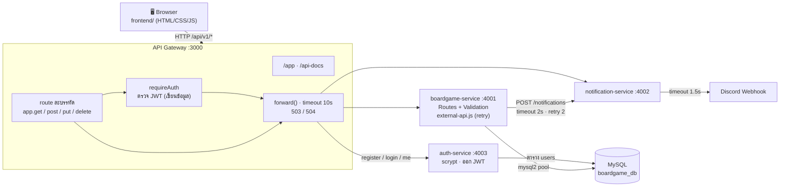

# สถาปัตยกรรมระบบ Board Game Management (ระยะที่ 3)

> การแบ่งบริการตาม Bounded Context, รูปแบบการสื่อสาร และจุดที่ต้องมี Resilience อยู่ใน [microservices-design.md](microservices-design.md) (ใบงานสัปดาห์ที่ 13)
> เอกสารนี้สรุปภาพรวมการทำงานจริงและเหตุผลการตัดสินใจทางเทคนิค

## 1. ภาพรวม

ระบบมี 4 process คุยกันผ่าน HTTP/JSON client เข้าถึงได้ทางเดียวคือ **API Gateway**

| Process | พอร์ต | โค้ด | หน้าที่ |
| --- | --- | --- | --- |
| API Gateway | 3000 | `gateway/index.js` | จุดเข้าถึงเดียว: routing, rate limiting, **ตรวจ JWT ก่อนเพิ่ม/แก้ไข/ลบ และตรวจ role admin ก่อนลบ**, 503/504, เสิร์ฟ Frontend (`/app`) และ Swagger (`/api-docs`) |
| boardgame-service | 4001 | `src/index.js`, `db.js`, `src/services/external-api.js` | CRUD บอร์ดเกม/หมวดหมู่/ความสัมพันธ์ N:M, validation, เชื่อมต่อ MySQL, เรียก notification-service พร้อม retry/timeout/fallback |
| notification-service | 4002 | `services/notification-service/index.js` | ส่งแจ้งเตือนเข้า Discord Webhook, เก็บประวัติ 50 รายการล่าสุด |
| auth-service | 4003 | `services/auth-service/index.js`, `password.js` | สมัครสมาชิก (ได้ member เสมอ), เข้าสู่ระบบ (ตรวจรหัสผ่าน scrypt) แล้วออก JWT ที่มี role, `/auth/me` |
| MySQL 8 | 3306 | `schema.sql`, `seed.sql`, `migrations/` | ตาราง `boardgames`/`categories`/`boardgame_categories` ของ boardgame-service และ `users` ของ auth-service (รันใน Docker) |

## 2. นโยบายสิทธิ์การเข้าถึง

| คำขอ | ต้องเข้าสู่ระบบ | หมายเหตุ |
| --- | --- | --- |
| `GET` บอร์ดเกม, หมวดหมู่, ความสัมพันธ์, ประวัติแจ้งเตือน, health | ไม่ต้อง (ผู้เยี่ยมชม) | ใครก็ดูแคตตาล็อกได้ |
| `POST /api/v1/auth/register`, `POST /api/v1/auth/login` | ไม่ต้อง | จำกัด 10 ครั้ง/นาที ต่อ IP กันการเดารหัสผ่าน |
| `GET /api/v1/auth/me` | **ต้อง** | ข้อมูลผู้ใช้จาก token |
| `POST` / `PUT` / `PATCH` บอร์ดเกม หมวดหมู่, ผูก/ถอดหมวดหมู่ของเกม (7 endpoint) | **ต้อง** (member ขึ้นไป) | ไม่มี token → 401 `UNAUTHORIZED`, หมดอายุ → 401 `TOKEN_EXPIRED`, ปลอม → 401 `INVALID_TOKEN` คำขอไม่ถูกส่งต่อไป service |
| `DELETE /api/v1/boardgames/{id}`, `DELETE /api/v1/categories/{id}` | **ต้องเป็น admin** | member → 403 `FORBIDDEN` (`requireAdmin`) ไม่ถูกส่งต่อ |

**role มาจากไหน:** สมัครผ่าน `POST /api/v1/auth/register` ได้ `member` เสมอ (ส่ง `role` มาก็ไม่สนใจ) ส่วน admin มาจาก (1) `ADMIN_USERNAME`/`ADMIN_PASSWORD` ใน `.env` ซึ่ง auth-service สร้าง/อัปเดตให้เป็น admin ทุกครั้งที่เปิด หรือ (2) `npm run create-admin` ที่ต้องรันบนเครื่องเซิร์ฟเวอร์ ทั้งสองทางต้องเข้าถึงเครื่องเซิร์ฟเวอร์ ไม่มี endpoint ไหนเปลี่ยน role ได้ จึงไม่มีช่องให้ยกระดับสิทธิ์ตัวเองผ่าน API

route ทั้งหมดเขียนบรรทัดละ 1 endpoint ใน `gateway/index.js` route ที่ต้องเข้าสู่ระบบมี `requireAuth` คั่นหน้า `forward(...)` อ่านบรรทัดเดียวก็รู้ว่า endpoint ไหนต้องมี token

ลำดับการเข้าสู่ระบบ

1. Frontend ส่ง `POST /api/v1/auth/login` → Gateway ส่งต่อไป auth-service
2. auth-service หาผู้ใช้ในตาราง `users` แล้วเทียบรหัสผ่านด้วย scrypt (เวลาคงที่ด้วย `timingSafeEqual`) ถูกต้อง → ออก JWT (HS256, อายุ 2 ชั่วโมง, payload `sub` = id ผู้ใช้, `username` และ `role`)
3. Frontend เก็บ token ใน `localStorage` แล้วแนบ `Authorization: Bearer <token>` ทุกคำขอ
4. คำขอเพิ่ม/แก้ไข/ลบ: Gateway `requireAuth` ตรวจลายเซ็นและวันหมดอายุด้วย `JWT_SECRET` เอง (ไม่ต้องถาม auth-service) ถ้าเป็นการลบ `requireAdmin` ตรวจ `role` ใน token ต่อ ผ่านแล้วจึงส่งต่อ
5. Gateway ตอบ 401 → Frontend ล้าง token และเปิดหน้าต่างเข้าสู่ระบบใหม่

## 3. การตัดสินใจทางเทคนิคและเหตุผล

| การตัดสินใจ | เหตุผล |
| --- | --- |
| **มี API Gateway เป็นจุดเข้าถึงเดียว** | client ไม่ต้องรู้ว่ามีกี่ service อยู่พอร์ตไหน, rate limit ที่เดียว, จัดการ service ล่มให้ตอบแบบเดียวกัน (503/504) |
| **แยก auth-service เป็น service ของตัวเอง** | การยืนยันตัวตนเป็นความรับผิดชอบด้านความปลอดภัยที่ถือความลับ (hash รหัสผ่าน) แยกแล้ว boardgame-service ไม่ต้องรู้เรื่องรหัสผ่านเลย และเปลี่ยนวิธีเข้าสู่ระบบ (เช่น Google) ได้โดยไม่แตะแคตตาล็อก |
| **Gateway ตรวจ JWT เอง ไม่เรียก auth-service ทุกคำขอ** | JWT ลงชื่อแล้ว ตรวจได้ด้วย `JWT_SECRET` อย่างเดียว ไม่เพิ่ม hop ทุกคำขอ และ auth-service ล่มก็ยังแก้ไขข้อมูลได้ด้วย token ที่มีอยู่ (เข้าสู่ระบบใหม่ไม่ได้อย่างเดียว) ข้อแลกเปลี่ยนคือเพิกถอน token ก่อนหมดอายุไม่ได้ จึงตั้งอายุสั้น (2 ชั่วโมง) |
| **ตรวจ token ที่ Gateway ไม่ใช่ที่ boardgame-service** | ตรวจที่เดียวครอบทุก service คำขอที่ไม่มีสิทธิ์ถูกตัดตั้งแต่ทางเข้าไม่เปลือง service และฐานข้อมูล (หลักเดียวกับ rate limit) ข้อควรระวังคือ service ภายในต้องเข้าถึงได้จาก Gateway เท่านั้น (ข้อ 5) |
| **GET ไม่ต้องเข้าสู่ระบบ** | แคตตาล็อกบอร์ดเกมเป็นข้อมูลสาธารณะ บังคับเฉพาะการเปลี่ยนแปลงข้อมูล |
| **ลบได้เฉพาะ admin แต่ member เพิ่ม/แก้ไขได้** | การลบย้อนไม่ได้ (ลบเกมแล้วความสัมพันธ์หายตาม CASCADE) ส่วนเพิ่ม/แก้ไขผิดก็แก้กลับได้ ถอดหมวดหมู่ออกจากเกมไม่ใช่การลบข้อมูล member จึงทำได้ |
| **role อยู่ใน token ไม่ถามฐานข้อมูลทุกคำขอ** | Gateway ตัดสินสิทธิ์ได้เองทันที ข้อแลกเปลี่ยนคือเปลี่ยน role แล้วต้องเข้าสู่ระบบใหม่จึงมีผล (token เก่ายังใช้ role เดิมจนหมดอายุ 2 ชั่วโมง) token รุ่นก่อนที่ไม่มี role ถือเป็น member |
| **admin หลักจาก `.env` + สคริปต์สำหรับ admin เพิ่มเติม และไม่มี API** | `.env` ทำให้ติดตั้งเครื่องใหม่แล้วมี admin ทันทีโดยไม่ต้องรันคำสั่งเพิ่ม และ `.env` เป็นตัวกำหนดรหัสของบัญชีนี้ (แก้แล้วรีสตาร์ท) ข้อแลกเปลี่ยนคือรหัสอยู่ในไฟล์เป็นข้อความธรรมดา จึงต้องไม่ commit `.env` (อยู่ใน `.gitignore`) ในฐานข้อมูลยังเก็บเป็น hash, สคริปต์ใช้สร้าง admin คนอื่นโดยไม่ต้องเขียนรหัสลงไฟล์, ไม่มี API เปลี่ยน role คนที่ไม่มีสิทธิ์เข้าเครื่องเซิร์ฟเวอร์จึงตั้งตัวเองเป็น admin ไม่ได้ |
| **403 ไม่ใช่ 401 เมื่อ member สั่งลบ** | 401 = ยังไม่รู้ว่าเป็นใคร (ให้เข้าสู่ระบบ) / 403 = รู้แล้วแต่ไม่มีสิทธิ์ (เข้าสู่ระบบใหม่ก็ไม่ช่วย) หน้าเว็บจึงไม่ออกจากระบบเมื่อได้ 403 |
| **รหัสผ่าน: scrypt + salt สุ่ม 16 ไบต์ (`crypto` ของ Node.js)** | hash ช้าโดยตั้งใจ เดารหัสทีละมากๆ ได้ยาก salt สุ่มทำให้รหัสเดียวกันได้ hash ต่างกัน ไม่ต้องติดตั้ง native module (bcrypt) |
| **รหัสผิดกับไม่มีผู้ใช้ตอบเหมือนกัน และใช้เวลาเท่ากัน** | ไม่บอกผู้โจมตีว่า username ไหนมีอยู่ในระบบ (กรณีไม่มีผู้ใช้ก็ยังคำนวณ scrypt กับ hash หลอก) |
| **ไม่มีค่า default ของ `JWT_SECRET`** | ถ้ามีค่า default ในโค้ด ใครอ่านโค้ดก็ปลอม token ได้ ไม่ตั้งค่า = เข้าสู่ระบบและการเขียนข้อมูลได้ 503 ชัดเจน |
| **Gateway ไม่ retry แต่ boardgame-service retry การแจ้งเตือน** | Gateway ส่งต่อ POST/DELETE ที่ไม่ idempotent ถ้า retry อาจเพิ่มเกมซ้ำ ส่วนการส่งแจ้งเตือนซ้ำเสียหายน้อย |
| **Gateway timeout 10 วินาที** | ต้องมากกว่าเวลาแย่สุดของ boardgame-service (~7.6 วินาที ตอน notification ค้าง) ไม่เช่นนั้น Gateway จะตอบ 504 ทั้งที่เกมถูกบันทึกแล้ว ผู้ใช้กดซ้ำจะได้ 409 สับสน |
| **retry ชั้นเดียว + timeout ลดหลั่น (Gateway 10s > boardgame 2s > notification 1.5s)** | ป้องกัน retry ทวีคูณ (3 × 3 = 9 ครั้ง) และให้ชั้นในตอบ error ได้ทันก่อนชั้นนอกตัดการรอ |
| **boardgame-service เรียก notification-service ตรง ไม่ผ่าน Gateway** | Gateway มีไว้สำหรับคำขอจาก client (north-south) การเรียกระหว่าง service (east-west) ไม่ต้องผ่าน rate limit ซ้ำและลด hop |
| **ไม่แยกบอร์ดเกมกับหมวดหมู่เป็นคนละ service** | ความสัมพันธ์ N:M ผูกด้วย FK/CASCADE และต้อง JOIN ตลอด ถ้าแยกจะเสียความถูกต้องที่ฐานข้อมูลรับประกัน |
| **`/api/v1/health` แยก ok / degraded / down** | notification หรือ auth ล่ม = degraded (200) เพราะยังดูข้อมูลได้, boardgame ล่ม = down (503) Frontend ใช้แสดงป้ายสถานะ |
| **Fallback: เพิ่มเกมยังตอบ 201 แม้แจ้งเตือนไม่สำเร็จ** | ข้อมูลหลักบันทึกแล้ว การแจ้งเตือนเป็นผลพลอยได้ แต่บอกผลชัดเจนในฟิลด์ `notification` |
| **Frontend HTML/CSS/JS ล้วน เสิร์ฟจาก Gateway ที่ `/app`** | ไม่ต้อง build, origin เดียวกับ API จึงไม่ติด CORS, ไม่มี inline script/`onclick` จึงผ่าน CSP ของ helmet (ปุ่มในรายการใช้ `data-action` แล้วดักคลิกที่ `<ul>`) |
| **เรียก API ผ่านฟังก์ชันเดียว `callApi(method, path, body)`** | ทุกปุ่มบนหน้าเว็บเห็นชัดว่าเรียก method และ path อะไร จัดการ error ที่เดียว (นำ `error.message` จาก API มาแสดง) |
| **escape ข้อความก่อนใส่ `innerHTML` (`escapeHtml`)** | กัน XSS เมื่อชื่อเกมมีโค้ด HTML เช่น `` |
| **Validation 3 ชั้น: Frontend, Backend และฐานข้อมูล** | Frontend ตรวจก่อนส่ง (ตอบผู้ใช้ทันที ไม่เปลืองคำขอ), Backend ตรวจซ้ำทุกช่องเพราะเรียก API ตรงได้ (Postman/curl), UNIQUE/CHECK เป็นด่านสุดท้ายกรณีคำขอพร้อมกัน |
| **Rate limit ที่ Gateway** (API ทั้งหมด 300 ครั้ง/นาที ต่อ IP) | ตัดคำขอเกินโควตาตั้งแต่ทางเข้า ไม่เปลือง service และฐานข้อมูล, `/api/v1/health` ไม่นับ ให้ป้ายสถานะทำงานเสมอ, ปรับ/ปิดได้ทาง `.env` ระหว่างซ้อม demo |
| **Cache ที่ boardgame-service ไม่ใช่ที่ Gateway** | service ที่เป็นเจ้าของข้อมูลรู้ว่าข้อมูลเปลี่ยนเมื่อไร จึงล้าง cache ได้ทันทีหลังเขียนสำเร็จ ถ้า cache ที่ Gateway ต้องเดาจาก URL และเสี่ยงข้อมูลเก่า เลือกล้างทั้งหมดเพราะข้อมูลน้อยและถูกต้องแน่นอนกว่าไล่ล้างทีละ key |
| **Cache ในหน่วยความจำ ไม่ใช้ Redis** | รันได้ทันทีไม่ต้องติดตั้งเพิ่ม ลดจุดที่จะพังตอน demo ข้อแลกเปลี่ยนคือใช้ได้กับ 1 instance (ดู `scalability-design.md`) |
| **Pagination แบบ page/limit พร้อม `total`** | หน้าเว็บแสดง "หน้า 1 / 3" ได้ จำกัด `limit` ไม่เกิน 100 กันคำขอเดียวดึงข้อมูลทั้งตาราง และเรียงด้วย `id` เป็นลำดับรองให้ผลแต่ละหน้าคงที่ |
| **คอลัมน์ที่เรียงได้มาจากรายการที่อนุญาตเท่านั้น** | ชื่อคอลัมน์ใน `ORDER BY` ใช้ placeholder `?` ไม่ได้ ถ้านำค่าจาก query ไปต่อ SQL ตรงๆ จะเกิด SQL Injection |
| **Migration แบบมีเวอร์ชัน (`schema_migrations`) แทนการรัน `schema.sql` ใหม่** | เปลี่ยนโครงสร้างฐานข้อมูลที่มีข้อมูลอยู่แล้วโดยไม่ต้องลบ, รู้ว่าแต่ละเครื่องอยู่เวอร์ชันไหน, ย้อนได้ด้วยไฟล์ `.down.sql` เขียนให้รันซ้ำได้เพราะ MySQL ครอบ DDL ด้วย transaction ไม่ได้ |

## 4. วิธีพิสูจน์ว่าเอกสารตรงกับโค้ด

`tests/openapi-code-match.test.js` อ่าน route จริงจาก Express ของทั้ง 4 process แล้วเทียบกับ `openapi.yaml`

- route ของ Gateway = operation ทั้งหมดที่ server เป็นพอร์ต 3000
- route `/api/v1/*` ของ boardgame-service = route ที่ Gateway ส่งต่อไปให้ (Gateway ไม่ตกหล่นหรือเกิน)
- route ของ notification-service = operation ที่พอร์ต 4002 / route ของ auth-service = operation ที่พอร์ต 4003
- route ของ Gateway ที่มี `requireAuth` = operation ของ Gateway ที่มี `security: bearerAuth` พอดี (10 endpoint) เอกสารจึงบอกถูกเสมอว่า endpoint ไหนต้องมี token
- route ที่มี `requireAdmin` = operation ที่มี response 403 `Forbidden` พอดี (2 endpoint)

## 5. ข้อจำกัดที่รู้อยู่

- มีแค่ 2 role (member / admin) ยังไม่มีหน้าจัดการผู้ใช้ เปลี่ยน role ได้ทางสคริปต์ `create-admin` เท่านั้น (ลดสิทธิ์ admin กลับเป็น member ต้องแก้ในฐานข้อมูลเอง)
- เปลี่ยน role แล้วมีผลเมื่อเข้าสู่ระบบใหม่ (role อยู่ใน token)
- เพิกถอน token ก่อนหมดอายุไม่ได้ (ออกจากระบบ = ลบ token ที่เบราว์เซอร์) ถ้าต้องการต้องมี refresh token หรือ blacklist
- token เก็บใน `localStorage` ถ้าหน้าเว็บมีช่องโหว่ XSS จะถูกขโมยได้ (ลดความเสี่ยงด้วย `escapeHtml` และ CSP ของ helmet) ทางที่ปลอดภัยกว่าคือ cookie แบบ `HttpOnly`
- auth-service ใช้ MySQL ตัวเดียวกับ boardgame-service (คนละตาราง ไม่มี service ไหนอ่านตารางของอีกฝ่าย) ถ้า deploy จริงควรแยก schema/ผู้ใช้ฐานข้อมูล
- rate limit, cache และประวัติแจ้งเตือนเก็บในหน่วยความจำของแต่ละ process ถ้ารันหลาย instance ต้องย้ายไป Redis (`scalability-design.md` ข้อ 2)
- rate limit นับตาม IP ผู้ใช้หลายคนหลัง NAT เดียวกัน (เช่นห้องแล็บ) ใช้โควตาร่วมกัน
- `GET /api/v1/boardgames` จัดกลุ่มทุกเกมก่อนแบ่งหน้า ที่ 100,000 เกมใช้ ~560 ms (`scalability-design.md` ข้อ 1)
- service ภายใน (4001-4003) ยังเปิดพอร์ตบนเครื่อง และ boardgame-service ไม่ตรวจ token เอง (เชื่อ Gateway) ถ้าเรียกพอร์ต 4001 ตรงจะข้ามการตรวจสิทธิ์ได้ ถ้า deploy จริงต้องอยู่ใน network ภายในที่เข้าถึงได้เฉพาะจาก Gateway
- การเพิ่มเกมรอผลแจ้งเตือนก่อนตอบ (synchronous) กรณีแย่สุด ~7.6 วินาที ควรเปลี่ยนเป็น asynchronous ผ่าน message queue
- ประวัติแจ้งเตือนเก็บในหน่วยความจำ หายเมื่อรีสตาร์ท notification-service
