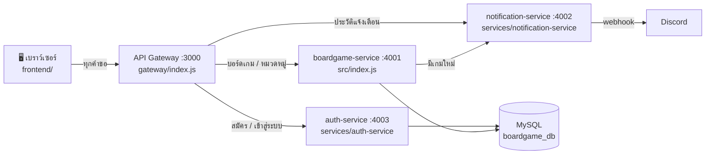

# อธิบายโค้ดทั้งหมด (Code Walkthrough)

เอกสารนี้อธิบายว่าโค้ดแต่ละไฟล์ทำอะไร ทำงานร่วมกันอย่างไร และทำไมเขียนแบบนั้น
อ่านคู่กับโค้ดได้เลย ชื่อฟังก์ชันที่อ้างถึงค้นในไฟล์ได้ตรงตัว (Ctrl+F)

- ภาพรวมสถาปัตยกรรมและเหตุผลการตัดสินใจ: [architecture.md](architecture.md)
- การแบ่ง service: [microservices-design.md](microservices-design.md)
- การรองรับข้อมูลที่โตขึ้น: [scalability-design.md](scalability-design.md)

---

## 1. ภาพรวม: ระบบมี 4 โปรแกรมที่รันแยกกัน

| โปรแกรม | ไฟล์หลัก | หน้าที่ในประโยคเดียว |
| --- | --- | --- |
| API Gateway | `gateway/index.js` | ประตูทางเข้าเดียว: ตรวจ rate limit, ตรวจ JWT ของคำขอเพิ่ม/แก้ไข/ลบ แล้วส่งต่อคำขอไป service ที่ถูกต้อง |
| boardgame-service | `src/index.js` | เก็บและจัดการข้อมูลบอร์ดเกม หมวดหมู่ และความสัมพันธ์ใน MySQL |
| notification-service | `services/notification-service/index.js` | ส่งข้อความเข้า Discord และเก็บประวัติ |
| auth-service | `services/auth-service/index.js` | สมัครสมาชิก ตรวจรหัสผ่าน และออก JWT (ตาราง `users`) |

ทุกตัวเป็น Express app ของตัวเอง คนละพอร์ต คนละ process ปิดตัวหนึ่งตัวอื่นยังทำงานต่อ
`npm start` (`scripts/start-all.js`) เปิดทั้ง 4 ตัวพร้อมกันให้

---

## 2. เดินตามคำขอจริง: ผู้ใช้กด "เพิ่มบอร์ดเกม Azul"

นี่คือ use case หลักที่ใช้ demo ตามดูได้ว่าคำขอเดียววิ่งผ่านโค้ดส่วนไหนบ้าง (ผู้ใช้เข้าสู่ระบบไว้แล้ว ดูขั้นตอนเข้าสู่ระบบใน 3.5.1)

### ขั้นที่ 1: หน้าเว็บส่งคำขอ

1. กดปุ่ม "เพิ่มบอร์ดเกม" → `submitGameForm()` ใน `frontend/app.js` อ่านค่าจากฟอร์มด้วย `readGameForm()` ได้ `{ name, minPlayers, maxPlayers }`
2. `validateGame()` ตรวจฝั่ง Frontend ก่อน ถ้าไม่ผ่าน `showFieldErrors()` แสดงข้อความใต้ช่องแล้วจบ ไม่ส่งคำขอ
3. `editingId` เป็น `null` (ไม่ได้อยู่ในโหมดแก้ไข) จึงเรียก `addGame(body)`
4. `addGame()` เรียก `callApi("POST", "/api/v1/boardgames", body)` ซึ่งใช้ `fetch` ส่ง JSON ไปที่ Gateway พร้อม header `Authorization: Bearer <token>` (token จาก `session` ที่ได้ตอนเข้าสู่ระบบ)
5. ถ้า API ตอบ 401 (token หมดอายุ) `callApi()` ล้าง `session` และเปิดหน้าต่างเข้าสู่ระบบ / error อื่น (เช่น 409 ชื่อซ้ำ) `callApi()` จะ throw พร้อม `error.message` จาก API แล้ว `submitGameForm()` นำข้อความไปแสดงใต้ฟอร์ม

### ขั้นที่ 2: Gateway ส่งต่อ

Middleware ทำงานเรียงตามนี้ ถ้าขั้นไหนไม่ผ่านจะตอบทันทีและไม่ส่งต่อ

| ลำดับ | middleware | ไม่ผ่านได้ |
| --- | --- | --- |
| 1 | `helmet`, `cors`, `express.json` (body ไม่เกิน 10 KB) | 400 JSON ผิดรูปแบบ / 413 ใหญ่เกิน |
| 2 | `apiLimiter` (300 คำขอ/นาที/IP) | 429 |
| 3 | `requireAuth` ตรวจ JWT ด้วย `JWT_SECRET` (ไม่ถาม auth-service) | 401 ไม่มี token / หมดอายุ / ปลอม |
| 4 | `forward("boardgame")` ส่งต่อด้วย axios ไปที่ `http://localhost:4001/api/v1/boardgames` | 503 service ปิด / 504 ช้าเกิน 10 วินาที |

route ทั้งหมดเขียนบรรทัดละ 1 endpoint ในส่วน ROUTES ของ `gateway/index.js`

### ขั้นที่ 3: boardgame-service บันทึกลงฐานข้อมูล

`app.post("/api/v1/boardgames")` ใน `src/index.js`

1. `validateBoardgameBody()` ตรวจซ้ำอีกรอบ (เพราะใครก็ยิง API ตรงได้ไม่ผ่านหน้าเว็บ)
2. `INSERT INTO boardgames ... VALUES (?, ?, ?)` ผ่าน `pool` จาก `db.js` (`?` กัน SQL Injection)
3. ชื่อซ้ำ: ฐานข้อมูลปฏิเสธด้วย UNIQUE ได้ `ER_DUP_ENTRY` แปลงเป็น 409
4. สำเร็จ: middleware `cacheResponses` (`src/cache.js`) เห็นว่าเป็นคำขอเขียนที่สำเร็จ จึงล้าง cache ทั้งหมด รายการที่โหลดครั้งถัดไปจึงเห็นเกมใหม่

### ขั้นที่ 4: ส่งแจ้งเตือน (service-to-service)

`notifyBoardgameCreated()` ใน `src/services/external-api.js` เรียก notification-service ตรง (ไม่ผ่าน Gateway)
ผ่าน `fetchWithRetry()` ที่มี

- **Timeout** 2 วินาทีต่อครั้ง (`AbortSignal.timeout`)
- **Retry** สูงสุด 2 ครั้งเมื่อ network error / timeout / 5xx โดยรอ 500 ms แล้ว 1000 ms (exponential backoff) ไม่ retry 4xx เพราะส่งซ้ำก็ผิดเหมือนเดิม
- **Fallback** ล้มเหลวทุกครั้งก็ไม่ throw แต่คืน `{ sent: false, message: "...ส่งแจ้งเตือนไม่สำเร็จ" }` การเพิ่มเกมจึงยังสำเร็จ (201)

notification-service (`POST /notifications`) ตรวจข้อมูล ส่งไป Discord ครั้งเดียวด้วย `sendToDiscord()` (timeout 1.5 วินาที) แล้ว `record()` เก็บประวัติ

### ขั้นที่ 5: คำตอบกลับถึงผู้ใช้

boardgame-service ตอบ `201 { data: เกมใหม่, notification: { sent, ... } }` → Gateway ส่งกลับตามเดิม →
หน้าเว็บขึ้น toast "เพิ่มแล้ว และแจ้งเตือนไปที่ Discord" (หรือสีเหลืองถ้า `sent: false`) แล้ว `loadGames()` / `loadNotifications()` โหลดใหม่

> **สรุปสั้นสำหรับตอบผู้สอน:** เบราว์เซอร์ (`addGame()` → `POST /api/v1/boardgames`) → Gateway (rate limit → `forward`) → boardgame-service (validate → INSERT → ล้าง cache) → notification-service (retry/timeout/fallback) → Discord

---

## 3. อธิบายทีละไฟล์

### 3.1 `gateway/index.js` — API Gateway

| ส่วน | ทำอะไร |
| --- | --- |
| `SERVICES()` | ที่อยู่ของแต่ละ service อ่านจาก env ทุกครั้งที่เรียก (ไม่ใช่ตอนโหลดไฟล์) test จึงชี้ไป stub server ได้ |
| `express.static` ที่ `/app` | เสิร์ฟไฟล์หน้าเว็บจากโฟลเดอร์ `frontend/` หน้าเว็บกับ API จึงอยู่ origin เดียวกัน ไม่ติด CORS |
| `swaggerUi` ที่ `/api-docs` | แสดงเอกสารจาก `openapi.yaml` |
| `createLimiter()`, `apiLimiter`, `authLimiter` | Rate limiting ด้วย `express-rate-limit` นับต่อ IP ในหน่วยความจำ ตอบ 429 ภาษาไทยพร้อมบอกว่ารออีกกี่วินาที ตั้ง `MAX=0` ปิดได้ `/health` ไม่นับ / login+register จำกัดเข้มกว่า 10 ครั้ง/นาที |
| `requireAdmin` | ใช้หลัง `requireAuth` กับ route ลบบอร์ดเกม/หมวดหมู่: `req.user.role` ไม่ใช่ `admin` → 403 `FORBIDDEN` ไม่ส่งต่อ |
| `requireAuth` | อ่าน header `Authorization: Bearer <token>` แล้ว `jwt.verify` (HS256 เท่านั้น) ผ่าน → `req.user` (id, username, role ไม่มี role ถือเป็น member) แล้วไปต่อ / ไม่ผ่าน → 401 (`UNAUTHORIZED`, `TOKEN_EXPIRED`, `INVALID_TOKEN`) / ไม่ตั้ง `JWT_SECRET` → 503 |
| `forward(serviceKey, toPath)` | ส่งคำขอต่อด้วย axios (method, body, query และ header `Authorization` เหมือนเดิม) และส่งคำตอบกลับตามเดิมรวม 4xx/5xx ติดต่อไม่ได้ → 503, ช้าเกิน → 504 และส่งต่อ header `X-Cache` |
| `GET /api/v1/health` | ถาม `/health` ของ 3 service พร้อมกัน สรุปเป็น `ok` / `degraded` (notification หรือ auth ล่ม แต่ยังดูข้อมูลได้) / `down` (boardgame ล่ม → 503) หน้าเว็บใช้แสดงป้ายสถานะ |
| ROUTES | บรรทัดละ 1 endpoint เช่น `app.post("/api/v1/boardgames", requireAuth, forward("boardgame"))` อ่านแล้วรู้เลยว่า path ไหนส่งไป service ไหน และต้องเข้าสู่ระบบหรือไม่ (มี `requireAuth` = ต้อง) |
| 404 และ error handler | เส้นทางที่ไม่มี → 404 `ROUTE_NOT_FOUND` / error อื่นตอบรูปแบบเดียวกันหมด |

Gateway **ไม่มี business logic และไม่ต่อฐานข้อมูล** ถ้าจะเพิ่มฟีเจอร์ใหม่เกี่ยวกับบอร์ดเกม แก้ที่ boardgame-service

### 3.2 `src/index.js` — boardgame-service

| ส่วน | ทำอะไร |
| --- | --- |
| HELPERS | ฟังก์ชันตรวจข้อมูล (`isPositiveInt`, `isValidName`, `isValidPlayerRange`) และสร้าง error response (`badRequest`, `invalidId`, `boardgameNotFound`, `duplicateName` ...) ใช้ซ้ำทุก route ข้อความ error จึงเหมือนกันทั้งระบบ |
| `validateBoardgameBody()` | ตรวจ body ของ POST/PUT: ครบทุกฟิลด์ → ชื่อถูกต้อง → เป็นจำนวนเต็ม → ช่วงถูกต้อง (ตรวจตามลำดับนี้ เจอข้อแรกที่ผิดก็ตอบ 400 พร้อม code เฉพาะ) |
| `GET /health` | `SELECT 1` ถ้าฐานข้อมูลตอบได้ = up ไม่ได้ = 503 |
| `parseListQuery()` + `SORT_COLUMNS` | ตรวจ `page`, `limit` (1-100), `sort` (ต้องอยู่ในรายการที่อนุญาต), `order` (asc/desc) **ชื่อคอลัมน์ใช้ `?` ไม่ได้ จึงต้องแปลงผ่านรายการที่อนุญาตเท่านั้น** กัน SQL Injection |
| `GET /api/v1/boardgames` | กรอง + แบ่งหน้า + เรียง: subquery จัดกลุ่ม `GROUP_CONCAT` ชื่อหมวดหมู่ของแต่ละเกม ข้างนอก `COUNT(*) OVER()` นับทั้งหมด แล้ว `ORDER BY` + `LIMIT/OFFSET` ตอบพร้อม `pagination` (ต้องใช้ subquery เพราะ MySQL 8.0 ไม่สน ORDER BY ถ้าใช้สองอย่างนี้ใน SELECT เดียวกัน) |
| `GET /api/v1/boardgames/:id` | เกมเดียวพร้อมหมวดหมู่ ไม่พบ → 404 |
| `POST` / `PUT` / `PATCH` / `DELETE` บอร์ดเกม | PUT ต้องส่งครบทุกฟิลด์, PATCH ส่งบางฟิลด์ได้ (อ่านค่าเดิมมารวมก่อนตรวจ max ≥ min), DELETE ลบความสัมพันธ์ตามด้วย CASCADE |
| CATEGORIES (5 endpoint) | CRUD หมวดหมู่ รายการมี `boardgameCount` ให้หน้าเว็บแสดง "Strategy (3)" |
| RELATION (3 endpoint) | ดู / ผูก / ถอดหมวดหมู่ของเกม ผูกซ้ำ → 409 `ALREADY_LINKED` |
| error handler | error ที่ไม่คาดคิด → 500 ข้อความกลางๆ (ไม่ส่งรายละเอียดภายในให้ client) แต่ log ไว้ฝั่ง server |
| `require.main === module` | เปิดพอร์ตเฉพาะตอนรันไฟล์นี้ตรงๆ ตอน test จะ `require` ไปใช้กับ Supertest โดยไม่เปิดพอร์ต (ใช้แบบเดียวกันทุก service) |

### 3.3 `src/cache.js` — Caching

- `cacheResponses` เป็น middleware ติดที่ `/api/v1` ของ boardgame-service
- **GET:** มีใน cache และยังไม่หมดอายุ → ตอบเลย (`X-Cache: HIT`) ไม่แตะฐานข้อมูล / ไม่มี → ปล่อยไปที่ route แล้วดักที่ `res.json` เก็บคำตอบ 200 ไว้ (`MISS`)
- **POST/PUT/PATCH/DELETE:** รอจนตอบเสร็จ ถ้าสำเร็จ (< 400) เรียก `clearCache()` ล้างทั้งหมด
- `generation`: ตัวเลขที่เพิ่มทุกครั้งที่ล้าง ถ้า GET อ่านฐานข้อมูลก่อนมีการแก้ไขแต่ตอบหลังการแก้ไข จะไม่ถูกเก็บลง cache (กันข้อมูลเก่าค้าง)
- จำกัด 100 รายการ, อายุ `CACHE_TTL_MS` (30 วินาที), ตั้ง 0 = ปิด (test ปิดไว้ใน `tests/setup-env.js`)

### 3.4 `src/services/external-api.js` — เรียก service อื่นอย่างทนทาน

- `fetchWithRetry(url, options, config)` ตัวกลางที่ใช้ซ้ำได้กับ API ภายนอกใดก็ได้ **ไม่ throw** คืน `{ ok, attempts, status, data, error }` เสมอ
- `notifyBoardgameCreated(game)` ใช้ `fetchWithRetry` เรียก notification-service แล้วแปลงผลเป็น `{ sent, attempts, message }` ให้ boardgame-service ใส่ในคำตอบ
- ค่า timeout / จำนวน retry / delay ปรับได้ทาง env (`EXTERNAL_API_*`) ใช้ตอนทดสอบ failure scenario

### 3.5 `services/notification-service/index.js`

- `POST /notifications` รับ `{ type: "boardgame.created", boardgame }` → สร้างข้อความ → `sendToDiscord()`
  - ไม่ได้ตั้ง webhook → 200 `sent: false` (ไม่ใช่ความผิดพลาดชั่วคราว ผู้เรียกไม่ต้อง retry)
  - Discord ล้มเหลว → 502 / ช้าเกิน → 504 (บอกผู้เรียกว่า retry ได้)
- `allowed_mentions: { parse: [] }` กันชื่อเกมที่มี `@everyone` ไปแท็กทุกคนในห้อง Discord
- `GET /notifications` คืนประวัติ 50 รายการล่าสุด (เก็บในหน่วยความจำ)
- **ไม่ retry เอง** retry อยู่ที่ฝั่งผู้เรียกที่เดียว ไม่เช่นนั้นจะ retry ซ้อนกันเป็น 3 × 3 = 9 ครั้ง

### 3.5.1 `services/auth-service/index.js` — สมัครสมาชิก / เข้าสู่ระบบ

| ส่วน | ทำอะไร |
| --- | --- |
| `password.js` | แยกโค้ดรหัสผ่านและกฎชื่อผู้ใช้ไว้ไฟล์เดียว ให้ทั้ง auth-service และ `scripts/create-admin.js` ใช้ร่วมกัน |
| `admin.js` | `createAdmin()` (ใช้โดยคำสั่ง create-admin) และ `syncEnvAdmin()` ทำให้บัญชีใน `ADMIN_USERNAME`/`ADMIN_PASSWORD` เป็น admin และรหัสตรงกับ `.env` |
| `setupEnvAdmin()` | เรียกหลัง `app.listen` ตั้งค่าไม่ครบคู่ → เตือนแล้วข้าม, ฐานข้อมูลยังไม่พร้อม → เตือน (บอกให้ migrate) แต่ service ไม่ล่ม |
| `hashPassword()` | สุ่ม salt 16 ไบต์ แล้ว `crypto.scrypt` เก็บเป็น `scrypt$<salt>$<hash>` ในคอลัมน์ `password_hash` (ไม่เก็บรหัสจริง) |
| `verifyPassword()` | คำนวณ scrypt ด้วย salt เดิมแล้วเทียบด้วย `crypto.timingSafeEqual` (ใช้เวลาเท่ากันเสมอ) hash รูปแบบผิดคืน `false` ไม่ crash |
| `dummyHash` | ไม่พบผู้ใช้ก็ยังเทียบกับ hash หลอก ให้เวลาตอบเท่ากับกรณีรหัสผิด เดาไม่ได้ว่า username ไหนมีอยู่ |
| `validateCredentials()` | ตอนสมัคร: username 3-30 ตัว (a-z, A-Z, 0-9, _), password 8-72 ตัว / ตอนเข้าสู่ระบบ: ตรวจแค่ว่าส่งมาครบ |
| `POST /auth/register` | INSERT ผู้ใช้ใหม่ (role เป็นค่า default `member` ไม่อ่าน `role` จาก body) ชื่อซ้ำ (UNIQUE ไม่สนตัวพิมพ์เล็ก/ใหญ่) → 409 `USERNAME_TAKEN` |
| `POST /auth/login` | ถูกต้อง → `jwt.sign({ sub: id, username, role }, JWT_SECRET, { expiresIn: "2h" })` / ผิด → 401 ข้อความเดียวกันทั้งชื่อผิดและรหัสผิด |
| `GET /auth/me` | ตรวจ token ซ้ำเองแล้วคืนข้อมูลผู้ใช้จากฐานข้อมูล (ผู้ใช้ถูกลบแล้ว → 401) |
| `GET /health` | `SELECT 1` ตรวจฐานข้อมูล ให้ Gateway รายงาน `authService` |

ฝั่งหน้าเว็บ (`frontend/app.js`): `login()` ได้ token แล้ว `saveSession()` เก็บใน `localStorage` → `renderAuth()` สลับ class `is-guest` ของ `<body>` ซึ่ง CSS ใช้ซ่อน/แสดงทุกอย่างที่มี class `requires-auth` / `guest-only` และวาดรายการใหม่ให้ปุ่มแก้ไข/ลบโผล่ ตอนเปิดหน้า `restoreSession()` เรียก `GET /api/v1/auth/me` ตรวจว่า token เดิมยังใช้ได้

### 3.6 `db.js`

Connection pool ของ mysql2 เปิด connection ค้างไว้สูงสุด 10 เส้นแล้วให้คำขอยืมใช้ ใช้โดย boardgame-service และ auth-service (คนละ process คนละ pool)

### 3.7 หน้าเว็บ `frontend/`

| ไฟล์ | เนื้อหา |
| --- | --- |
| `index.html` | โครงหน้า: รายการเกม (การเรียง, ปุ่มเปลี่ยนหน้า), ฟอร์มเพิ่ม/แก้ไขเกม, ฟอร์มเพิ่มหมวดหมู่, การแจ้งเตือน, หน้าต่าง (`<dialog>`) จัดการหมวดหมู่ของเกม และหน้าต่างเข้าสู่ระบบ/สมัครสมาชิก แต่ละส่วนมีคอมเมนต์บอก endpoint ที่ใช้ ไม่มี JavaScript ในไฟล์ (ผ่าน CSP ของ helmet) |
| `style.css` | สีและขนาดเก็บเป็นตัวแปร CSS รองรับจอมือถือ |
| `app.js` | ตรรกะทั้งหมด บนสุดของไฟล์มีตาราง "ปุ่ม → ฟังก์ชัน → endpoint" และหัวของแต่ละฟังก์ชันเขียน endpoint ไว้ |

ฟังก์ชันใน `app.js` (เข้าสู่ระบบแล้ว `callApi()` แนบ token ให้ทุกคำขอ):

| ฟังก์ชัน | ทำอะไร | Endpoint |
| --- | --- | --- |
| `callApi(method, path, body)` | ตัวกลางเรียก API ด้วย `fetch` ถ้า API ตอบ 4xx/5xx จะ throw `Error` ที่มีข้อความ `error.message` จาก API | - |
| `escapeHtml()` | แปลง `< > & "` ก่อนใส่ใน `innerHTML` กัน XSS | - |
| `login()` / `register()` / `logout()` | เข้าสู่ระบบ (เก็บ token), สมัครแล้วเข้าสู่ระบบต่อทันที, ออกจากระบบ (ลบ token) | `POST /api/v1/auth/login`, `POST /api/v1/auth/register` |
| `restoreSession()` | เปิดหน้ามามี token เดิม ตรวจว่ายังใช้ได้ | `GET /api/v1/auth/me` |
| `validateAuth()` | ตรวจฟอร์มเข้าสู่ระบบ/สมัคร (รูปแบบชื่อ, ความยาวรหัส, รหัสยืนยันตรงกัน) ก่อนส่ง | - |
| `withBusyButton()` | ระหว่างรอ API ปิดปุ่มและเปลี่ยนข้อความเป็น "กำลังบันทึก..." กันกดซ้ำ | - |
| `validateGame()` / `validateCategory()` | ตรวจฟอร์มฝั่ง Frontend ก่อนส่ง (กฎเดียวกับ API: ชื่อ 1-100 ตัวอักษร, ผู้เล่นเป็นจำนวนเต็ม ≥ 1, max ≥ min) ไม่ผ่านจะไม่ส่งคำขอเลย | - |
| `showFieldErrors()` | แสดงข้อความใต้ช่องที่ผิด ทำกรอบแดง (`aria-invalid`) และย้ายเคอร์เซอร์ไปช่องแรกที่ผิด | - |
| `loadHealth()` | ป้ายสถานะ เขียว / เหลือง / แดง | `GET /api/v1/health` |
| `loadCategories()` | เก็บหมวดหมู่ทั้งหมดไว้ในตัวแปร `categories` ให้หน้าต่างหมวดหมู่ใช้ทำตัวเลือก "เพิ่ม" | `GET /api/v1/categories` |
| `addCategory()` | ฟอร์มเพิ่มหมวดหมู่ | `POST /api/v1/categories` |
| `updateCategory()` | กดชื่อหมวดหมู่ แก้ไขแล้วบันทึก | `PUT /api/v1/categories/:id` |
| `deleteCategory()` | ปุ่ม ✕ ในรายการหมวดหมู่ทั้งหมด | `DELETE /api/v1/categories/:id` |
| `loadGames()` + `renderGames()` + `renderPager()` | สร้าง query `page/limit/sort/order` แล้วแสดงรายการและปุ่มเปลี่ยนหน้า | `GET /api/v1/boardgames?...` |
| `submitGameForm()` | ฟอร์มเดียวใช้ทั้งเพิ่มและแก้ไข: `editingId` เป็น `null` เรียก `addGame()` ไม่เช่นนั้นเรียก `updateGame()` | - |
| `addGame()` | เพิ่มเกม แล้วบอกผลการแจ้งเตือน Discord | `POST /api/v1/boardgames` |
| `updateGame()` | บันทึกการแก้ไข | `PUT /api/v1/boardgames/:id` |
| `startEdit()` / `resetGameForm()` | เข้า/ออกโหมดแก้ไข (ไม่เรียก API) | - |
| `deleteGame()` | ถามยืนยันแล้วลบ | `DELETE /api/v1/boardgames/:id` |
| `openCategoriesDialog()` + `loadGameCategories()` | เปิดหน้าต่างหมวดหมู่ของเกม | `GET /api/v1/boardgames/:id/categories` |
| `linkCategory()` | ผูกหมวดหมู่ที่เลือกเข้ากับเกม | `POST /api/v1/boardgames/:id/categories` |
| `unlinkCategory()` | ถอดหมวดหมู่ออกจากเกม (ปุ่ม ✕) | `DELETE /api/v1/boardgames/:id/categories/:categoryId` |
| `loadNotifications()` | แสดงประวัติจาก notification-service | `GET /api/v1/notifications` |

ปุ่มในรายการเกม (หมวดหมู่ / แก้ไข / ลบ) ถูกสร้างใหม่ทุกครั้งที่โหลด จึงใส่ `data-action` และ `data-id` ไว้ที่ปุ่ม แล้วดักคลิกที่ `<ul id="games-list">` ตัวเดียว (ใช้ `onclick="..."` ใน HTML ไม่ได้เพราะ CSP ของ helmet บล็อก)

### 3.8 ฐานข้อมูลและ migration

| ไฟล์ | เนื้อหา |
| --- | --- |
| `migrations/001_*.sql` | ตาราง `boardgames`, `categories`, `boardgame_categories` (N:M, FK + CASCADE, UNIQUE, CHECK) |
| `migrations/002_*.sql` | ตาราง `users` ของ auth-service เดิม (ถูกลบใน 004) |
| `migrations/003_*.sql` | เพิ่มคอลัมน์ `created_at` ให้เรียง "เพิ่มล่าสุดก่อน" (ตรวจ `information_schema` ก่อน รันซ้ำได้) |
| `migrations/004_*.sql` | ลบตาราง `users` รุ่นเดิม (มีคอลัมน์ `role`) ตอนตัดระบบ login รุ่นแรกออก |
| `migrations/005_*.sql` | สร้างตาราง `users` ของ auth-service รุ่นปัจจุบัน (username UNIQUE, password_hash) |
| `migrations/006_*.sql` | เพิ่มคอลัมน์ `role` (`member` / `admin`, ค่าเริ่มต้น member) ตรวจ `information_schema` ก่อน รันซ้ำได้ |
| `*.down.sql` | ไฟล์ย้อนกลับของแต่ละเวอร์ชัน |
| `scripts/migrate.js` | `up` รันไฟล์ที่ยังไม่เคยรัน, `down` ย้อนไฟล์ล่าสุด, `status` ดูสถานะ จำว่ารันอะไรไปแล้วในตาราง `schema_migrations` |
| `schema.sql` | โครงสร้างล่าสุดทั้งหมดในไฟล์เดียว (snapshot) |
| `seed.sql` | ล้างแล้วใส่ข้อมูลตัวอย่าง 3 เกม 3 หมวด |

### 3.9 สคริปต์อื่น

- `scripts/start-all.js` เปิด 4 process (Gateway + 3 service) ในคำสั่งเดียว Ctrl+C ปิดทั้งหมด `--watch` รีสตาร์ทเมื่อแก้โค้ด
- `scripts/create-admin.js` สร้างบัญชี admin (ถามรหัสผ่านแบบไม่แสดงบนจอ) หรือเลื่อนผู้ใช้เดิมเป็น admin ฟังก์ชันหลัก `createAdmin()` รับ `pool` จากข้างนอกเพื่อให้ test ได้โดยไม่ต้องมี MySQL
- `scripts/mock-external.js` server ปลอมที่ตอบ ok / 503 / ช้า 10 วินาที ใช้ทดสอบ retry / timeout / fallback

### 3.10 การทดสอบ `tests/`

| ไฟล์ | ทดสอบ |
| --- | --- |
| `boardgames.test.js`, `categories.test.js`, `boardgame-categories.test.js`, `system.test.js` | ทุก endpoint ของ boardgame-service โดย mock `db` (ไม่ต้องมี MySQL) |
| `gateway.test.js` | Gateway กับ stub server จริง: ส่งต่อถูกที่, ไม่มี token → 401 / token หมดอายุ / ปลอม, มี token → ส่งต่อ, 503/504 |
| `auth-service.test.js` | สมัคร (hash + salt, ได้ member เสมอ), เข้าสู่ระบบ (JWT มี role), รหัสผิด, /auth/me, ไม่ตั้ง `JWT_SECRET` |
| `create-admin.test.js` | สร้าง admin ใหม่, เลื่อนผู้ใช้เดิม, เป็น admin อยู่แล้ว, ข้อมูลผิด |
| `rate-limit.test.js` | 429, โควตาคืนเมื่อครบเวลา, ปิดได้, login/register 10 ครั้ง/นาที |
| `cache.test.js` | HIT/MISS, ล้างเมื่อเขียน, TTL |
| `notification-service.test.js`, `external-api.test.js` | Discord สำเร็จ/ล้ม/ช้า, retry, timeout, fallback |
| `openapi-code-match.test.js` | route จริงในโค้ดทั้ง 4 process ตรงกับ `openapi.yaml` และ route ที่มี `requireAuth` ตรงกับ `security: bearerAuth` |
| `setup-env.js` | ไม่ใช่ test: ปิด cache ก่อนทุก test |

รายละเอียดและตัวเลข coverage: [coverage-report.md](coverage-report.md)

---

## 4. รูปแบบที่ใช้ซ้ำทั่วโปรเจกต์ (เข้าใจตรงนี้แล้วอ่านทุกไฟล์ได้)

| รูปแบบ | ตัวอย่าง | ทำไม |
| --- | --- | --- |
| error รูปแบบเดียวกันทุก service | `{ "error": { "code": "NOT_FOUND", "message": "ไม่พบบอร์ดเกม" } }` | โปรแกรมใช้ `code` ตัดสินใจ ผู้ใช้อ่าน `message` หน้าเว็บนำ `message` ไปแสดงได้เลย |
| ตรวจข้อมูล 2 ชั้น | API → ฐานข้อมูล (UNIQUE/CHECK/FK) | API ตรวจทุกคำขอ (หน้าเว็บแค่แสดงข้อความ error ที่ได้), ฐานข้อมูลกันคำขอพร้อมกัน |
| SQL ใช้ `?` เสมอ | `pool.query("... WHERE id = ?", [id])` | mysql2 escape ค่าให้ กัน SQL Injection |
| อ่าน env ตอนใช้งาน ไม่ใช่ตอนโหลดไฟล์ | `timeoutMs()`, `ttlMs()`, `SERVICES()` | test เปลี่ยนค่าได้ระหว่างรัน และปรับระบบได้โดยไม่แก้โค้ด |
| `if (require.main === module) app.listen(...)` | ท้ายทุก service | test `require` app ไปใช้กับ Supertest โดยไม่เปิดพอร์ตจริง |
| `listen` เช็ค error | พอร์ตไม่ว่าง → แจ้งชัดเจนแล้วปิด | Express 5 ส่ง error ให้ callback แทนการ throw ถ้าไม่เช็คจะขึ้นว่า "กำลังทำงาน" ทั้งที่ไม่ได้ทำงาน |
| escape ก่อนใส่ `innerHTML` | `` `
${escapeHtml(game.name)}
` `` | กัน XSS เมื่อชื่อเกมมีโค้ด HTML |
