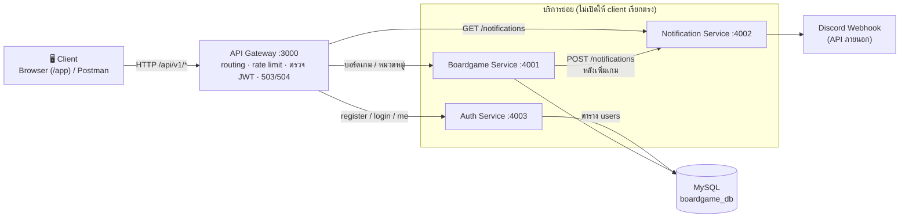
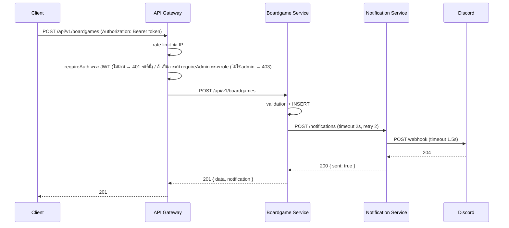

# ออกแบบสถาปัตยกรรม Microservices ของระบบจัดการข้อมูลบอร์ดเกม

ใบงานปฏิบัติการสัปดาห์ที่ 13 (ส่วนที่ 3.2) นำแนวคิดจาก services-lab (Student Service + API Gateway) มาใช้กับระบบโครงงาน
และได้ **แยกโค้ดจริงแล้วทั้งหมด** ในระยะที่ 3 (ไม่ใช่เพียงการออกแบบ) รันด้วย `npm start`

## การแบ่งบริการ

แบ่งตาม **Bounded Context** (ขอบเขตของความหมายทางธุรกิจ) ไม่ได้แบ่งตามชั้นทางเทคนิค (เช่น แยก controller/model เป็นคนละ service)

| บริการ | Bounded Context / ความรับผิดชอบ | ข้อมูลที่เป็นเจ้าของ | Endpoint หลัก |
| --- | --- | --- | --- |
| **API Gateway** (3000) — *ไม่ใช่บริการย่อย* | จุดเข้าถึงเดียวของ client: routing, rate limiting, ตรวจ JWT ก่อนเพิ่ม/แก้ไข/ลบ และ role admin ก่อนลบ, ตอบ 503/504 เมื่อบริการปลายทางมีปัญหา, ให้บริการหน้าเว็บ `/app` และ `/api-docs` | ไม่มี (ไม่มี business logic) | `GET /api/v1/health`, ส่งต่อ `/api/v1/*` ทั้งหมด |
| **Boardgame Service** (4001) | **แคตตาล็อกบอร์ดเกม**: ข้อมูลบอร์ดเกม หมวดหมู่ และความสัมพันธ์ N:M พร้อมกฎทางธุรกิจ (ชื่อห้ามซ้ำ, ผู้เล่น ≥ 1, max ≥ min) | MySQL `boardgame_db` (`boardgames`, `categories`, `boardgame_categories`) | `GET/POST /api/v1/boardgames`, `GET/PUT/PATCH/DELETE /api/v1/boardgames/{id}`, `GET/POST /api/v1/categories`, `GET/PUT/DELETE /api/v1/categories/{id}`, `GET/POST /api/v1/boardgames/{id}/categories`, `DELETE /api/v1/boardgames/{id}/categories/{categoryId}`, `GET /health` |
| **Notification Service** (4002) | **การแจ้งเตือน**: แปลงเหตุการณ์ "มีบอร์ดเกมใหม่" เป็นข้อความ แล้วส่งไป Discord Webhook (API ภายนอก) และเก็บประวัติ | ประวัติการแจ้งเตือน (ในหน่วยความจำ) และ `DISCORD_WEBHOOK_URL` | `POST /notifications`, `GET /notifications`, `GET /health` |
| **Auth Service** (4003) | **ตัวตนผู้ใช้**: สมัครสมาชิก ตรวจรหัสผ่าน และออก JWT ที่มี role | ตาราง `users` (username, scrypt hash, role member/admin) และ `JWT_SECRET` (ใช้ร่วมกับ Gateway เพื่อตรวจ token) | `POST /auth/register`, `POST /auth/login`, `GET /auth/me`, `GET /health` |

### เหตุผลของการแบ่ง

- **บอร์ดเกมกับหมวดหมู่อยู่ service เดียวกัน** เพราะเป็น context เดียว ผูกกันด้วย Foreign Key และ `ON DELETE CASCADE` ต้อง JOIN กันในเกือบทุกคำขอ ถ้าแยกจะเสียความถูกต้องที่ฐานข้อมูลรับประกันให้ และต้องเรียกข้าม service ตลอด
- **การแจ้งเตือนแยกออกมา** เพราะเปลี่ยนด้วยเหตุผลคนละแบบกับแคตตาล็อก (เช่น เปลี่ยนจาก Discord เป็น LINE/Email) และพึ่ง API ภายนอกที่ล่มหรือช้าได้ แยกแล้วปัญหาไม่ลามไปที่การจัดการบอร์ดเกม
- **แต่ละ service มีข้อมูลของตัวเอง** ไม่มี service ไหนอ่านข้อมูลของ service อื่นตรงๆ: ตารางแคตตาล็อกเป็นของ Boardgame Service, ตาราง `users` เป็นของ Auth Service, Notification Service เก็บประวัติในหน่วยความจำของตัวเอง (ตอนนี้ 2 service ใช้ MySQL ตัวเดียวกันแต่คนละตาราง เพื่อให้รันง่าย ถ้า deploy จริงควรแยก schema)
- **Auth แยกเป็น service ของตัวเอง** เพราะเป็นความรับผิดชอบด้านความปลอดภัยที่ถือความลับ (hash รหัสผ่าน) Boardgame Service ไม่ต้องรู้เรื่องผู้ใช้เลย ส่วนการตรวจ token ทำที่ Gateway ด้วย `JWT_SECRET` เดียวกัน จึงไม่ต้องเรียก Auth Service ทุกคำขอ

## แผนภาพสถาปัตยกรรม

ลำดับการทำงานของคำขอที่เปลี่ยนแปลงข้อมูล (เพิ่มบอร์ดเกม)

## รูปแบบการสื่อสาร

| จาก | ไป | รูปแบบ | เหตุผล |
| --- | --- | --- | --- |
| Client | API Gateway | Synchronous (HTTP/REST) | ผู้ใช้รอผลบนหน้าจอทันที เช่น รายการเกม ผลการบันทึก |
| API Gateway | Boardgame Service | Synchronous (HTTP) | Gateway เป็นเพียงตัวส่งต่อ ต้องได้ผลจริงจาก service เพื่อตอบ client (รวมถึง 400/404/409) |
| API Gateway | Notification Service | Synchronous (HTTP) | เป็นการอ่านประวัติ (query) ที่ผู้ใช้กดดูและรอผล |
| API Gateway | Auth Service | Synchronous (HTTP) | ผู้ใช้รอผลการเข้าสู่ระบบ/สมัครทันที (ต้องได้ token กลับมา) |
| Boardgame Service | Notification Service | **Synchronous ในระยะนี้** (ควรเป็น **Asynchronous**) | เลือก sync เพื่อให้ response บอกผลการแจ้งเตือน (`notification.sent`) ได้ทันทีและไม่ต้องมี message broker แต่การแจ้งเตือนเป็น *ผลพลอยได้* ที่ไม่จำเป็นต้องเสร็จก่อนตอบผู้ใช้ ข้อเสียที่วัดได้คือกรณีแย่สุดการเพิ่มเกมช้าถึง ~7.6 วินาที (ดู `failure-scenario-results.md`) ถ้าต่อยอด ควรเปลี่ยนเป็น async: บันทึกเกมแล้ว publish event `boardgame.created` เข้า message queue (เช่น RabbitMQ) ให้ Notification Service มารับไปทำเอง แล้วตอบผู้ใช้ทันที |
| Notification Service | Discord Webhook | Synchronous (HTTP) | Discord Webhook รองรับเฉพาะ HTTP request/response |

## จุดที่ต้องมี Resilience

| บริการที่เรียก | บริการปลายทาง | ต้องมี Retry/Timeout/Fallback หรือไม่ | เหตุผล / สิ่งที่ทำจริงในโค้ด |
| --- | --- | --- | --- |
| API Gateway | Boardgame Service | **Timeout + Fallback** (ไม่ Retry) | timeout 10 วินาที → 504 `GATEWAY_TIMEOUT`, ติดต่อไม่ได้ → 503 `SERVICE_UNAVAILABLE` ไม่ retry เพราะ POST ไม่ idempotent ถ้าลองซ้ำอาจได้ข้อมูลซ้ำ timeout ต้องมากกว่าเวลาแย่สุดของ service (~7.6 วินาที) ไม่เช่นนั้น Gateway จะตอบ 504 ทั้งที่เกมถูกบันทึกแล้ว |
| API Gateway | Notification Service | **Timeout + Fallback** | ดูประวัติไม่ได้ → 503 ผู้ใช้กด "ลองใหม่" เองได้ |
| API Gateway | Auth Service | **Timeout + Fallback** (ไม่ Retry) | ล่ม → 503 สมัคร/เข้าสู่ระบบใหม่ไม่ได้ แต่ **token เดิมยังใช้แก้ไขข้อมูลได้** เพราะ Gateway ตรวจ JWT เองไม่ต้องพึ่ง Auth Service ไม่ retry login เพราะนับรวมกับ rate limit ของการเดารหัสผ่าน |
| API Gateway | ทุก service (`/health`) | **Timeout** 2 วินาที | สรุปเป็น `ok` / `degraded` (notification หรือ auth ล่ม) / `down` (boardgame ล่ม) |
| Boardgame Service | Notification Service | **Retry + Timeout + Fallback** (ครบทั้งสาม ตามสัปดาห์ที่ 11) | timeout 2 วินาที, retry 2 ครั้ง (exponential backoff 500 → 1000 ms) เมื่อ network error / timeout / 5xx, fallback: เพิ่มเกมยังตอบ 201 พร้อม `notification.sent = false` (`src/services/external-api.js`) retry ได้เพราะการส่งแจ้งเตือนซ้ำเสียหายน้อย (อย่างมากข้อความซ้ำ) |
| Notification Service | Discord Webhook | **Timeout** 1.5 วินาที (ไม่ Retry ที่ชั้นนี้) | แปลงความล้มเหลวเป็น 502/504 ให้ Boardgame Service retry ชั้นเดียว ถ้า retry ทั้งสองชั้นจะกลายเป็น 3 × 3 = 9 ครั้ง timeout ตั้งให้น้อยกว่าของผู้เรียก (2 วินาที) เพื่อให้ตอบ 504 ได้ทันก่อนผู้เรียกตัดการรอ |
| Boardgame Service | MySQL | Connection pool (ไม่ Retry) | ฐานข้อมูลล่ม → 500 ที่คำขอ และ `/health` ตอบ 503 ให้ Gateway รายงาน `down` |

## ผลการทดสอบ

- กรณีบริการย่อยล่ม/ค้างผ่าน Gateway (เทียบจุดตรวจสอบที่ 3 ของ lab) และกรณี Discord ล้มเหลว อยู่ใน `failure-scenario-results.md`
- การทดสอบอัตโนมัติของ Gateway (routing, ไม่มี token → 401 / มี token → ส่งต่อ, auth-service ล่มแต่ token เดิมยังใช้ได้, 503, 504, health) อยู่ใน `tests/gateway.test.js` และของ Auth Service อยู่ใน `tests/auth-service.test.js`
