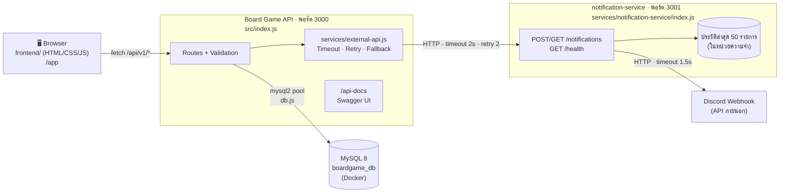
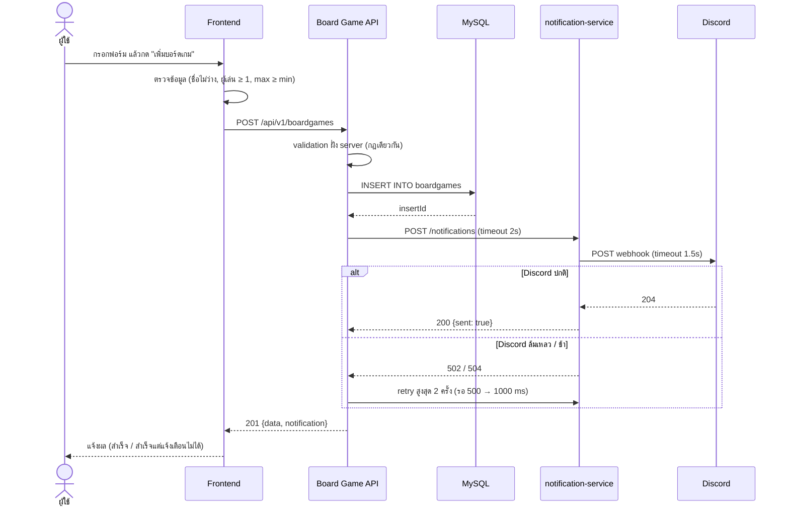

# สถาปัตยกรรมระบบ Board Game Management (ระยะที่ 3)

## 1. ภาพรวม

ระบบประกอบด้วย 2 service ที่รันเป็นคนละ process คุยกันผ่าน HTTP/JSON และหน้าเว็บ Frontend ที่ API หลักให้บริการ

| ส่วน                  | เทคโนโลยี                         | หน้าที่                                                                 |
| --------------------- | --------------------------------- | ----------------------------------------------------------------------- |
| Frontend              | HTML/CSS/JavaScript ล้วน           | หน้าจอจัดการบอร์ดเกม/หมวดหมู่ เรียก API จริงด้วย `fetch`                 |
| Board Game API        | Node.js, Express 5, mysql2         | CRUD บอร์ดเกม หมวดหมู่ ความสัมพันธ์ N:M, validation, Swagger UI, health |
| notification-service  | Node.js, Express 5                 | รับคำขอแจ้งเตือนแล้วส่งต่อ Discord, เก็บประวัติ                          |
| ฐานข้อมูล             | MySQL 8 (Docker)                   | 3 ตาราง พร้อม PK/FK/UNIQUE/CHECK/ON DELETE CASCADE                      |

## 2. ลำดับการทำงานของ Use Case หลัก: เพิ่มบอร์ดเกม

## 3. การตัดสินใจทางเทคนิคและเหตุผล

| การตัดสินใจ | เหตุผล |
| --- | --- |
| **แยกการแจ้งเตือนเป็น microservice** | การแจ้งเตือนเป็นงานรองที่พึ่งบริการภายนอก (Discord) ซึ่งล่มหรือช้าได้ แยกออกมาทำให้ (1) ล่มแล้วไม่ลากระบบหลักลงไปด้วย (2) เปลี่ยนช่องทางแจ้งเตือน เช่น LINE/Email ได้โดยไม่แตะ API หลัก (3) API หลักไม่ต้องถือ Webhook URL ซึ่งเป็นความลับ |
| **ไม่แยกบอร์ดเกมกับหมวดหมู่เป็นคนละ service** | สองส่วนนี้มีความสัมพันธ์ N:M ผูกกันด้วย Foreign Key และต้อง JOIN กันตลอด ถ้าแยกจะต้องเรียกข้าม service และเสีย FK/CASCADE ที่ฐานข้อมูลรับประกันให้ |
| **Retry อยู่ฝั่งผู้เรียก (API หลัก) ชั้นเดียว** | ถ้าทั้งสองชั้น retry จะเกิด 3 × 3 = 9 ครั้งและรอนานมาก notification-service จึงส่ง Discord ครั้งเดียวแล้วตอบ 5xx เพื่อบอกให้ผู้เรียก retry |
| **Timeout ของ service (1.5s) น้อยกว่าของผู้เรียก (2s)** | ให้ notification-service ตอบ 504 พร้อมเหตุผลได้ทันก่อนที่ API หลักจะตัดการรอ |
| **ไม่ได้ตั้งค่า webhook → 200 `sent:false` ไม่ใช่ 5xx** | เป็นความผิดพลาดถาวร retry ก็ไม่ช่วย จึงไม่ควรเสียเวลา 1.5 วินาทีไป retry |
| **Fallback: เพิ่มเกมยังตอบ 201** | ข้อมูลหลักบันทึกสำเร็จแล้ว การแจ้งเตือนเป็นผลพลอยได้ จึงไม่ควรทำให้ผู้ใช้คิดว่าการเพิ่มเกมล้มเหลว แต่บอกผลแจ้งเตือนชัดเจนในฟิลด์ `notification` |
| **`/api/v1/health` แยก ok / degraded / down** | notification-service ล่ม = degraded (200) เพราะระบบหลักยังใช้ได้ ส่วนฐานข้อมูลล่ม = down (503) Frontend ใช้แสดงป้ายสถานะ |
| **Frontend ใช้ HTML/CSS/JS ล้วน เสิร์ฟจาก API ที่ `/app`** | ไม่ต้อง build อยู่ origin เดียวกับ API จึงไม่ติด CORS และสอดคล้องกับ CSP ของ helmet (ไม่มี inline script) |
| **ใช้ `textContent` แทน `innerHTML` ใน Frontend** | กัน XSS เมื่อชื่อเกมที่ผู้ใช้กรอกมีโค้ด HTML |
| **Validation ทั้ง Frontend และ Backend** | Frontend ช่วยให้ผู้ใช้รู้ข้อผิดพลาดทันที แต่ Backend ต้องตรวจซ้ำเสมอเพราะเรียก API ตรงได้โดยไม่ผ่านหน้าเว็บ |
| **ฐานข้อมูลบังคับกฎซ้ำ (UNIQUE, CHECK)** | เป็นด่านสุดท้าย ถ้ามีคำขอสองอันชื่อซ้ำพร้อมกัน UNIQUE จะกันได้ แล้ว API แปลงเป็น 409 |
| **ประวัติแจ้งเตือนเก็บในหน่วยความจำ** | ง่ายและพอสำหรับโครงงาน ข้อจำกัดคือหายเมื่อรีสตาร์ท ถ้าใช้จริงควรเก็บลงฐานข้อมูลของ service เอง |

## 4. Endpoint ทั้งหมด

ดูรายละเอียดเต็มใน `openapi.yaml` หรือ Swagger UI ที่ `http://localhost:3000/api-docs`

| Service | Method | Path |
| --- | --- | --- |
| API | GET | `/` |
| API | GET | `/api/v1/health` |
| API | GET, POST | `/api/v1/boardgames` |
| API | GET, PUT, PATCH, DELETE | `/api/v1/boardgames/{id}` |
| API | GET, POST | `/api/v1/categories` |
| API | GET, PUT, DELETE | `/api/v1/categories/{id}` |
| API | GET, POST | `/api/v1/boardgames/{id}/categories` |
| API | DELETE | `/api/v1/boardgames/{id}/categories/{categoryId}` |
| API | GET | `/api/v1/notifications` |
| notification-service | GET | `/health` |
| notification-service | GET, POST | `/notifications` |

รวม API หลัก 17 operation และ notification-service 3 operation

## 5. ข้อจำกัดที่รู้อยู่

- ยังไม่มีการยืนยันตัวตน ผู้ใช้ทุกคนแก้ไขข้อมูลได้ (requirement กำหนดบทบาท Admin ไว้ แต่ยังไม่ได้ทำในระยะนี้)
- การเพิ่มเกมรอผลแจ้งเตือนก่อนตอบ กรณีแย่สุดใช้เวลาประมาณ 7.6 วินาที ทางแก้ในอนาคตคือส่งแจ้งเตือนแบบ asynchronous (เช่นผ่าน message queue) แล้วตอบผู้ใช้ทันที
- notification-service ยังไม่มีฐานข้อมูลของตัวเอง ประวัติหายเมื่อรีสตาร์ท
